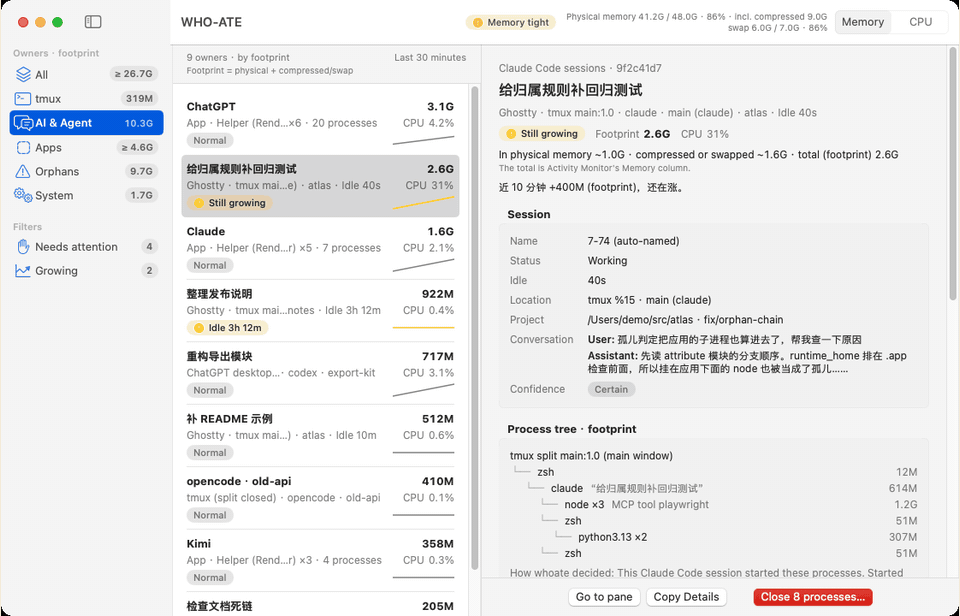
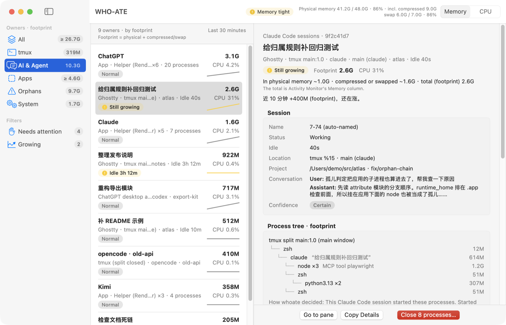
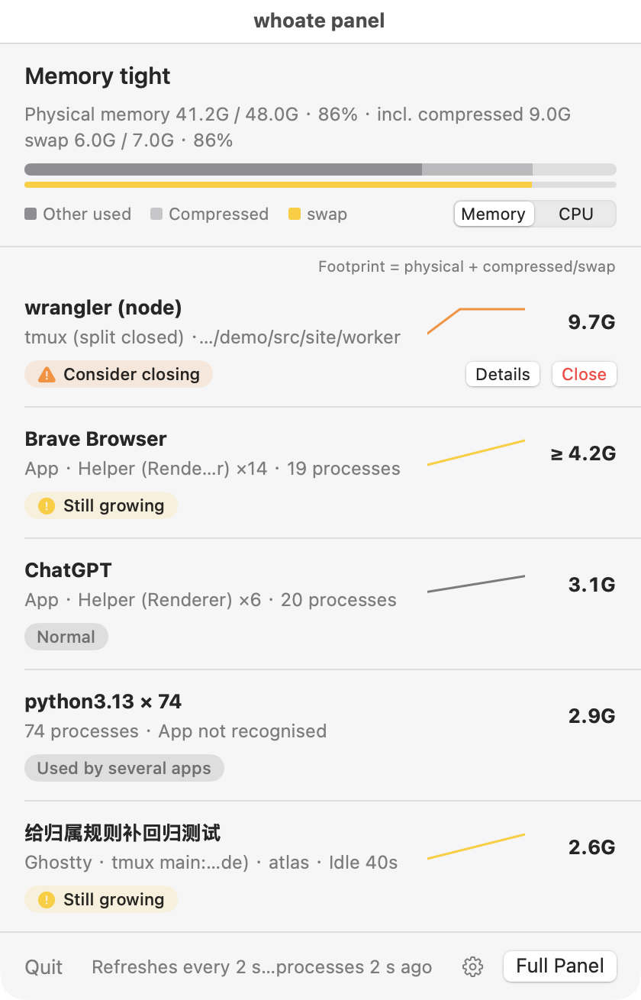
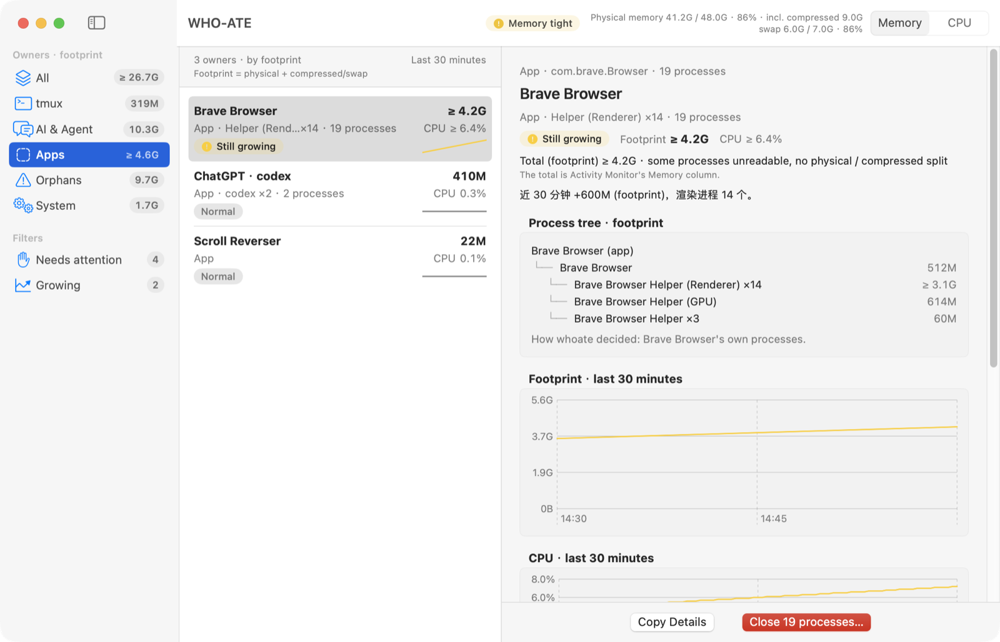
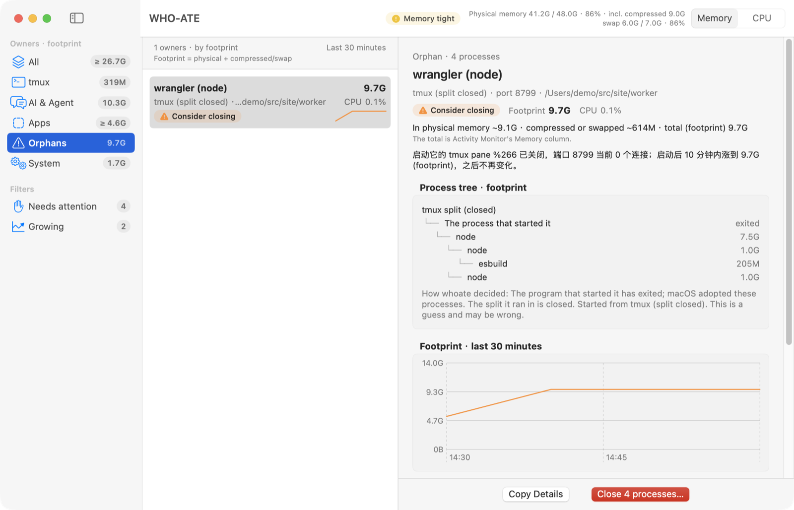
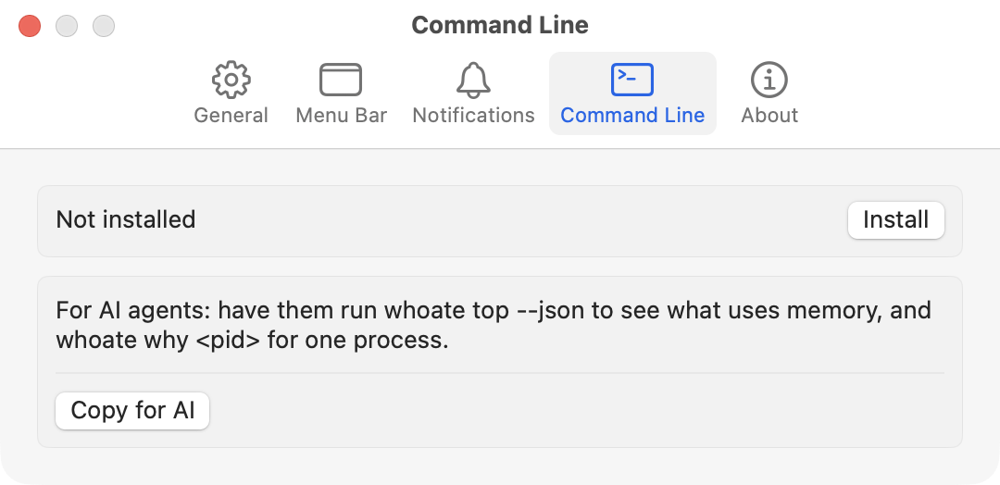
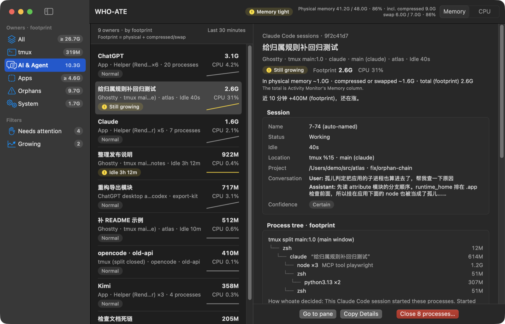

<p align="center"></p>

# whoate

See which agent session, tmux pane or app is eating your Mac's memory — and let your coding agent ask too.



```sh
brew install zhenninglang/tap/whoate
```

## How is it different from Activity Monitor?

- **Owners, not a list of process names.** Memory and CPU are grouped by the
  coding-agent session, the tmux pane and the app that started them, each with
  all its helpers.
- **Orphans show up.** whoate finds the processes a closed terminal left behind
  and tells you where they came from.
- **A CLI made for agents.** Your coding agent gets structured JSON and exit codes
  from one command; the diagnosis is rule-based on your Mac, so it spends zero tokens.

## Use it from a coding agent

```sh
whoate top --json                    # owners ranked by memory
whoate why 12345 --json              # who owns this pid, and why
whoate agent-guide                   # the agent instructions (SKILL.md)
whoate top --by cpu -n 20 --json     # by CPU
whoate orphans --json                # leftovers from closed terminals
whoate agents --json                 # coding-agent sessions
whoate pane '%12' --json             # everything under a tmux pane
whoate swarms --json                 # many copies of the same command
whoate watch --interval 2s --json-lines
whoate kill 12345 --dry-run          # preview; --yes only after a human approves
whoate insights --list               # every knowledge-base entry, with source and date
```

- Every JSON document has `schema: "whoate/v1"`. Memory is in **bytes**; CPU is
  percent of one core. `null` means unknown, never zero.
- Each owner's optional `origin.launched_from` says where it was started (a
  terminal app, a tmux pane, or the app that launched it).
- Exit codes: `0` normal, `1` an "act" diagnosis or a fatal error (JSON then
  carries `error`), `2` bad arguments, `3` target not found, `4` refused for
  safety (root, Apple platform binaries and whoate itself are never killed).
- Conversation text stays out by default: the first prompt and reply are `null`
  unless you pass `--prompts`.

Give your agent the instructions: `whoate agent-guide` prints `SKILL.md`. Save it
as `.claude/skills/whoate/SKILL.md` (Claude Code), `.kilocode/skills/whoate/SKILL.md`
(Kilo) or `.opencode/skills/whoate/SKILL.md` (OpenCode):

```sh
mkdir -p .claude/skills/whoate && whoate agent-guide > .claude/skills/whoate/SKILL.md
```

The JSON Schema is installed at `$(brew --prefix)/share/whoate/whoate-v1.schema.json`
(the Release tarball has it under `schema/`); the source is
[`schema/whoate-v1.schema.json`](schema/whoate-v1.schema.json).

## What it knows

- **Per-software insight.** whoate knows how each piece of software splits into
  processes and explains them in that software's own terms: an agent session
  and its MCP servers, Chrome's tab and extension processes, Docker's VM and
  containers, an IDE's language servers. Advice comes from a built-in knowledge
  base where every entry cites its source.
- **Made for agents, zero tokens.** One command gives your coding agent
  structured JSON (`schema: "whoate/v1"`) and meaningful exit codes. Diagnosis
  is rule-based on your machine: no model calls, no network, no tokens spent.

In the app, the left column groups owners into categories such as **AI & Agent**
(coding-agent sessions and AI apps), apps and orphans. Its numbers, like the
**Owners · footprint** list, are footprint: physical memory plus compressed or
swapped memory, so owners can add up to more than your RAM. Each row starts with
where the owner was launched from, for example `Ghostty · tmux main:10.1`.

[Product page](https://zhenninglang.github.io/whoate/) · [Releases](https://github.com/ZhenningLang/whoate/releases) · [Changelog](CHANGELOG.md) · [中文说明](#中文说明)



| Menu bar panel | A browser and its helper processes |
|---|---|
|  |  |
| **An orphan from a closed terminal** | **Settings → Command Line** |
|  |  |
| **Dark mode** | |
|  | |

## Install

Apple Silicon, macOS 14 (Sonoma) or later.

```sh
brew install zhenninglang/tap/whoate
```

That installs the `whoate` CLI. The menu bar app:

```sh
brew install --cask zhenninglang/tap/whoate
```

or download the `…-macos-arm64-app.zip` asset from
[Releases](https://github.com/ZhenningLang/whoate/releases) and move `whoate.app`
to Applications.

The app also carries the CLI. With the app alone, put it on your PATH from
whoate **Settings → Command Line → Install**. If you later install the formula
and Homebrew reports a link conflict, run `brew link --overwrite whoate`.

### First launch of the app

whoate.app is ad-hoc signed but **not notarized** (notarization needs a paid
Apple Developer account; v1 skips it). macOS therefore blocks the first launch.
To allow it once:

1. Open whoate.app; macOS says it cannot verify the developer. Click **Done**.
2. Open **System Settings → Privacy & Security**, scroll to the message about
   whoate, and click **Open Anyway**. Confirm with your password or Touch ID.

Or remove the quarantine flag in Terminal:

```sh
xattr -d com.apple.quarantine /Applications/whoate.app
```

Upgrade with `brew upgrade whoate` and `brew upgrade --cask whoate`; the app never
checks for updates and never goes online. Uninstalling and building from source:
[docs/install.md](docs/install.md).

## Your own rules

Name your own processes and attach advice in `~/.config/whoate/rules.toml`
(override the path with `WHOATE_RULES`). Each `[[rules]]` entry needs a `label`,
an `advice`, and at least one matcher; the first matching rule wins.

| Field | Meaning |
|---|---|
| `executable` | File name of the executable, e.g. `node` (not a path) |
| `argv_regex` | Regular expression matched against the full command line |
| `cwd_prefix` | The process's working directory starts with this path |
| `label` | Name shown for the owner (required) |
| `advice` | Your advice, shown as a fact on the owner (required) |

```toml
[[rules]]
executable = "node"
argv_regex = "vite( |$)"
cwd_prefix = "/Users/me/work/shop"
label = "Shop dev server"
advice = "Stop it with Ctrl-C in its pane when you are done."
```

Unknown fields, empty matchers or a bad regex disable the whole file; whoate
then reports an issue with `stage: "user_rules"` in the JSON `issues[]`.

## Privacy

whoate only reads local process and session information. It does not use the
network, does not call any model, and never changes another application's
settings; advice is for you to act on.

## 中文说明

**看清是哪个编程助手会话、哪个 tmux 分屏、哪个应用在吃 Mac 的内存，也让你的编程助手自己来查。**

### 和活动监视器有什么不同

- **按归属看，而不是一串进程名**：内存和 CPU 按启动它们的编程助手会话、tmux 分屏和应用归到一起，连同各自带起来的子进程。
- **能看出孤儿进程**：找出终端关掉后留下的进程，并写明它们从哪来。
- **给 agent 用的命令行**：一条命令给编程助手结构化 JSON 和退出码；诊断在本机按规则完成，零 token。

whoate 还按各个软件自己的结构解释进程，例如编程助手会话和它的 MCP 服务、Chrome 的标签页进程与扩展进程、Docker 的虚拟机与容器、IDE 的语言服务。建议来自内置知识库，每条都附出处和核对日期（`whoate insights --list` 可全部列出）。

应用左栏按类别分组，例如「AI & Agent」（编程助手会话和 AI 应用）、应用、孤儿进程。左栏和「归属 · 占用」列表里的数字是占用：占用 = 物理内存 + 压缩/swap，所以各归属相加可以超过物理内存总量。每行开头写从哪启动，例如 `Ghostty · tmux main:10.1`。

### 安装与首次打开

只支持 Apple Silicon、macOS 14 及以上。

```sh
brew install zhenninglang/tap/whoate            # 命令行
brew install --cask zhenninglang/tap/whoate     # 菜单栏应用
```

应用里也带了命令行工具。只装了应用时，在 whoate **设置 → 命令行 →「安装」** 把它放进 PATH；之后再用 Homebrew 装命令行、提示链接冲突时，运行 `brew link --overwrite whoate`。更新用 `brew upgrade whoate`、`brew upgrade --cask whoate`；应用不会自己检查更新，也不联网。

应用没有做 Apple 公证（第一版不办开发者账号），首次打开会被系统拦下。放行步骤：先打开一次 whoate.app，在弹窗里点「完成」；然后打开 **系统设置 → 隐私与安全性**，在页面下方找到 whoate 的提示，点 **「仍要打开」**，再输入密码或用触控 ID 确认。也可以在终端执行 `xattr -d com.apple.quarantine /Applications/whoate.app`。

### 给 agent 用

- 让 agent 运行 `whoate top --json`（谁占内存）、`whoate why <pid>`（某个进程归谁、为什么）、`whoate agent-guide`（给 agent 的完整说明）；内存单位是字节，`null` 表示未知、不是 0。
- 退出码：0 正常；1 有需要处理的诊断或致命错误；2 参数错误；3 目标不存在；4 因安全原因拒绝。
- `whoate agent-guide` 打印 SKILL.md，按上文放进 `.claude/skills/whoate/` 等目录即可。
- 结束进程先 `whoate kill <目标> --dry-run` 预览，人同意后才加 `--yes`。
- 自定义规则写在 `~/.config/whoate/rules.toml`，格式见上文「Your own rules」。

介绍页：<https://zhenninglang.github.io/whoate/> · 更新记录：[CHANGELOG.md](CHANGELOG.md)

## License

[MIT](LICENSE)
