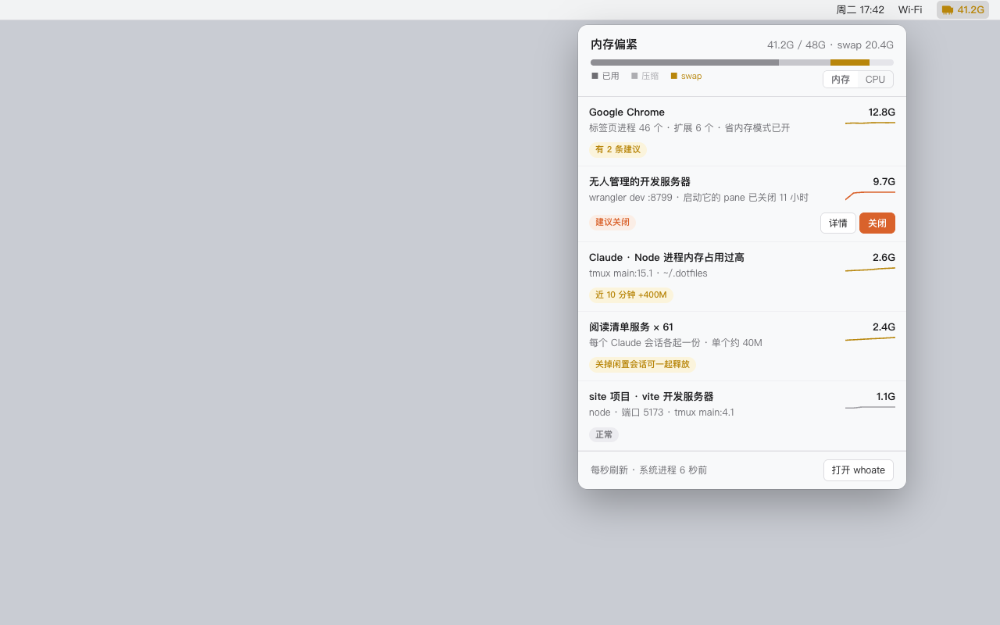
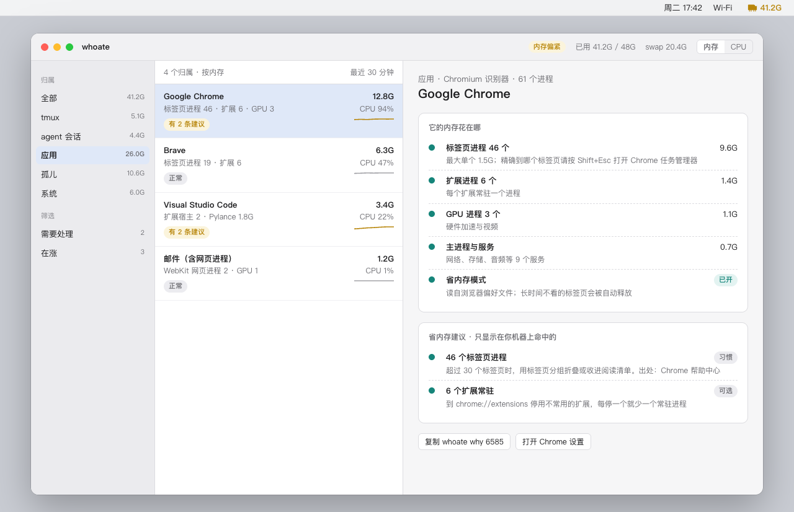
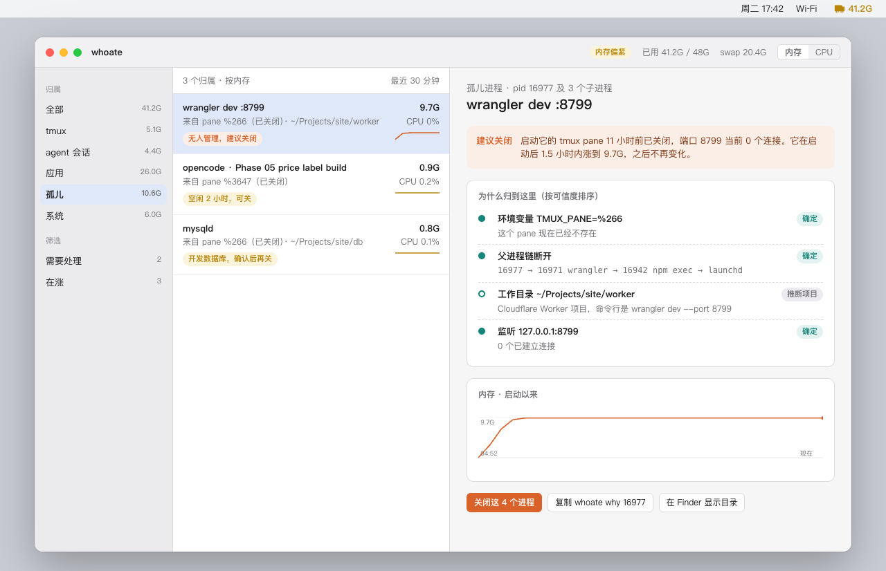
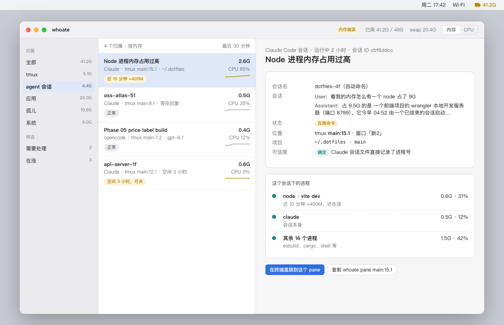

Audience:   P1 审批 owner
Scope:      whoate v1 的审批投影——定位改为按软件定制洞察后，要拍的 2 件事、撤不回来的事、分期与验收 / Non-scope: 实现细节（见 overview.md）
State:      approved
Genre:      G-APPROVAL
Code-Root:  /Users/zhenninglang/Projects/whoate-docs-design
Prefixes:   U-DEC, U-BEH, U-GATE, U-SPK, U-ACC, U-NG, U-DEP, U-DIAG

# whoate · 审批投影

```d2
direction: right
你: 你
菜单栏: 菜单栏里的小图标
终端窗口: 你开着助手的终端窗口 · 已定 ⑥ { class: decision }
各种软件: 浏览器、编辑器、编程助手
小众软件: 你自己常用的小众软件 · 已定 ⑦ { class: decision }
省内存建议: 针对这个软件的省内存建议
你 -> 菜单栏: 看谁占了内存
菜单栏 -> 各种软件: 用它们自己的说法解释
各种软件 -> 省内存建议: 你机器上命中才显示
菜单栏 -> 终端窗口: 一键跳回那个会话
你 -> 小众软件: 自己写一行规则补上
```

这张图想让读者看懂：最后拍板的两件事，一件管「点了跳转按钮能跳到哪」，一件管「你能不能给自己的小众软件补识别」；设计已全部定好。

## 1. 现在哪儿坏了、不改会怎样

今天上午一个程序占了 9.7G 内存，活动监视器只显示它叫「node」，查清它是谁花了 9 次工具调用（[U-DIAG-1|a758]）。本机已有的内存快照报告也没把它列出来，因为它在报告窗口开始前就涨完了（[U-DIAG-2|7070]）。

翻你这台机器过去 30 天的记录，问题分两类：平时最占内存的是浏览器，网页进程平均 2.6G、Brave 和 Chrome 合计近 5G；真正把机器拖垮的是编程工具突然暴涨，opencode 单个进程到过 92.5G、python 到过 27G、node 到过 12.2G（[U-DIAG-3|6572]）。浏览器和 Docker 各自有内部视角，比如浏览器的任务管理器，但它们互相不通，也不认识你的项目和会话；编程工具这一类则没有任何现成工具在管。

还有一类问题按「谁启动的」分组会被漏掉：一堆同样的小进程分散在各处，单个不起眼，加起来很大。你机器上此刻就有：每个 Claude 会话各起一份阅读清单服务，61 个进程单个约 40M，合计 2.38G，散在 21 个会话下，没有一个能排进前 5（[U-DIAG-4|fb34]）。whoate 会把这类同样的进程合成一行，比如「阅读清单服务 × 61」；如果是一个程序在几分钟内拉起几十个相同进程，会直接标成「疑似失控」并给出一键关掉整组。

所以 whoate 的卖点改为「按软件定制的洞察」：认出每个软件的进程是什么，并告诉你在你这台机器上具体能怎么省。

### 核心概念

- **识别器**：每种软件一个，用那个软件自己的话解释它的进程。例：Chrome 识别器把 61 个进程拆成「标签页 46 个、扩展 6 个、GPU 3 个」，并从偏好文件读出你已经开了省内存模式。
- **归属**：一个进程记在谁名下，人一眼认得出，同一个进程只记一次。例：「tmux 窗口 15 里那个 Claude 会话」「site 项目的 vite 开发服务器」「一个终端已关掉的孤儿」。
- **诊断**：对每个归属的一句话判断。例：「无人管理的开发服务器，建议关闭」；只有该处理的那一档才给按钮。

### 页面示意

菜单栏面板：点菜单栏图标弹出。顶部是内存压力条和「内存 / CPU」排序切换，下面是占得最多的 5 行，用软件自己的说法描述，例如 Chrome 一行写「标签页进程 46 个 · 扩展 6 个 · 省内存模式已开」，同样的小进程合成一行写「阅读清单服务 × 61」。



浏览器详情：右栏先把 Chrome 的内存按标签页、扩展、GPU、服务拆开，再列出只在你机器上命中的省内存建议，每条带出处。



孤儿进程详情：右栏依次是一句诊断、证据清单、内存曲线和三个动作按钮。



助手会话详情：右栏显示会话名，名字下面一行叫「会话」，是这个会话开头的一问一答，例如「User: 看我的内存怎么有一个 node 占了 9G」和助手回复的开头；再往下是自动标题、所在终端位置和跳转按钮。



完整的点击路径对照见 walkthrough.md。

## 2. 要你拍的 0 件事

本轮没有待拍的事。两轮评审一共拍了七件事，全部按建议走，结论见第 7 节。

## 3. 撤不回来的与会变的

名字 whoate 已经公开，再改要动仓库、安装命令、程序名和给助手的说明文件（[U-GATE-1|2104]）。给助手用的数据格式一旦发布，别人的脚本就会依赖它，所以只加字段不改字段，真要改就升到第 2 版并让旧版继续可用（[U-GATE-2|ec3c]）。安装渠道会多一个公开仓库专门放安装公式（[U-GATE-3|8918]）。

会变的行为有四条。这个工具能结束进程，先列出要关的进程、要确认，系统进程和它自己一律拒绝（[U-BEH-1|033d]）。它会只读本机 Claude Code、opencode、kilo 的会话记录来认出会话（[U-BEH-2|4f08]）。它会调用一个苹果没公开的接口，把网页进程和虚拟机归到真正发起它们的应用，比如把两个网页进程归到「邮件」；哪天系统去掉这个接口，它们退回显示为后台服务（[U-BEH-3|85a7]）。它会只读浏览器、VS Code、JetBrains、Docker 的设置文件，判断哪条建议在你机器上成立，不读网址和浏览历史，也不改任何设置（[U-BEH-4|a61f]）。

## 4. 代价、新增依赖与运维负担

新增的都是开源库或免费服务，没有付费项。

- 命令行参数解析库 clap：九个子命令的参数和帮助文本（[U-DEP-1|b55d]）。
- JSON 序列化库 serde：给助手的数据格式与浏览器设置文件都靠它（[U-DEP-2|7600]）。
- 系统调用绑定 libc：读进程内存和 CPU 的系统接口（[U-DEP-3|e267]）。
- SQLite 读取库 rusqlite：读 opencode、kilo 的会话库（[U-DEP-4|a231]）。
- GitHub 的 macOS 自动测试机：别人提的改动有机器把关，公开仓库免费（[U-DEP-5|a60c]）。
- 一个新公开仓库 homebrew-tap：放安装公式（[U-DEP-6|b3fe]）。
- 应用信息读取库 plist：读每个应用的名字和标识（[U-DEP-7|bbd9]）。

运维负担：每次发版跑一个发布脚本；省内存建议的知识库要定期核对，每条都带核对日期和出处（[U-SPK-10|e74f]）。比不做贵在哪：未评估，主要成本是开发时间。

## 5. 分几期、多久、每期拿到什么、怎么算做完

分六期，按 agent 吞吐估一共两到三天 [推断：依据是规模估计约 5000 行加知识库，没有同类项目实测]。第三、四、五期可以同时做。

第一期把数据读准：随机抽 10 个进程，读到的内存和系统 `top` 命令差不到 1%，读一遍不到 50 毫秒；公开的测试数据保留参数名、抹掉取值（[U-ACC-1|d344]）。第二期认准编程工具：用这台机器录下的真实数据回放，孤儿、Claude 会话、opencode 会话、Chrome、系统进程五种情况全部归对（[U-ACC-2|2d64]）。同一期做同类进程合并：用 19:40 录下的快照回放，那时的 69 个阅读清单服务合成一行；再现场让一个程序 1 分钟内拉起 30 个相同进程，一条命令就能把它认成「疑似失控」并指出是谁拉起的（[U-ACC-10|8816]）。

第三期扩到其他软件：node 认出项目名、python 认出虚拟环境、浏览器拆出标签页和扩展、网页进程归到真正的应用、VS Code 拆出扩展宿主和语言服务、PyCharm 读出内存上限，PyCharm 没在跑时用构造的数据验证（[U-ACC-8|a592]）；知识库每条都有出处，你这台机器至少命中一条浏览器建议和一条编程助手建议（[U-ACC-9|f303]）。

第四期出命令行：有缓存时一条命令不到 0.3 秒返回（[U-ACC-3|3ad1]）。现场验证两件事：在终端里起一个小网页服务再把那个终端关掉，一条命令能找回它来自哪个 pane（[U-ACC-4|ba7a]）；对这个会话本身跑一次，返回的会话名、标题和开头的一问一答与 Claude 自己记的一致（[U-ACC-5|061f]）。

第五期出界面：菜单栏面板和主窗口浅色、深色各截一张，文字不溢出；每秒刷新时它自己平均 CPU 不到 1%；点「关闭」先弹确认；每秒刷新压不到 1% 就改成每 2 秒刷新（[U-ACC-6|fc20]）。第六期发布：换一个干净的用户目录按说明一行命令装好能用，下载页有命令行和应用两个包，介绍页能打开（[U-ACC-7|40e3]）。

## 6. 最可能翻车的假设

已经验证的有五条。没有 Xcode 也能把 Rust 核心接进 Mac 界面（[U-SPK-1|07fa]）。读进程内存够快，702 个进程 4 毫秒（[U-SPK-2|4f56]）。孤儿进程还记得自己来自哪个终端，抽查 10 个有 9 个能读到（[U-SPK-3|4f53]）。苹果没公开的那个接口今天能用，不需要管理员权限就把 12 个网页进程归到了邮件、Raycast 等应用（[U-SPK-7|5580]）。浏览器能按进程类型拆开，但精确到「是哪个标签页」做不到，因为 Chrome 提供这个能力的接口只在开发版里有（[U-SPK-8|c1d7]）。

接受风险的有三条：opencode 和 kilo 的会话靠「同目录、启动时间相近」配对，同一目录开好几个会话可能配错（[U-SPK-4|2147]）；Claude 的会话文件是内部格式，改了就退化成只显示目录（[U-SPK-5|c4ec]）；知识库会随软件改版过时（[U-SPK-10|e74f]）。

需要 spike 的两条：界面每秒刷新时自己的 CPU 能不能压在 1% 以下，第五期第一步测，不达标改 2 秒刷新（[U-SPK-6|8f90]）；Docker 能不能把虚拟机的内存拆到每个容器，今天 Docker 没在运行没法测，第三期开 Docker 测半小时，拆不到容器就只显示整体占用（[U-SPK-9|36c2]）。

## 7. 已定死不用你看的

名字、MIT、Rust 加 SwiftUI 加命令行、不做 TUI、只做 macOS、诊断由规则生成不调模型、走 dev-long-run，都是你今天已经拍过的。

2026-10-14 评审页拍板的五件事：第一版不做公证，有人用起来再办账号（[U-DEC-1|d7c7]）；助手默认看不到你在别的会话里开头的一问一答（[U-DEC-2|ac64]）；允许助手写明确认后关程序，系统程序一律拒绝（[U-DEC-3|8bb7]）；界面跟随系统语言，中英双语（[U-DEC-4|fcd2]）；介绍页用 GitHub 免费网页托管公开发布（[U-DEC-5|e8d0]）。

2026-10-14 第二轮评审拍板的两件事：跳转按钮第一版只做 tmux 切换，iTerm2 和系统终端的精确跳转放下一期（[U-DEC-6|fe85]）；第一版就支持用户规则文件（[U-DEC-7|81dc]）。

2026-10-14 对话里定的：定位改为按软件定制的洞察，第一版做六类识别器——编程助手加 tmux、node 和 python 这类开发运行时、Chrome 和 Brave、网页进程的宿主应用、Docker、VS Code 和 PyCharm。原来「不用苹果私有接口」的边界因此作废（[U-NG-5|86bb]）。

## 8. 没写进这一页的

[U-NG-*] 其余不做的事（不做 Linux 和 Windows、不做长期历史库与告警、不做需要 root 的取证、不认 Codex 等其他助手、不做 TUI、不调大模型、浏览器不精确到具体标签页、不替你改软件设置）——去向：overview.md「边界」节。
除此之外全部登记单元均已在本页出现。
