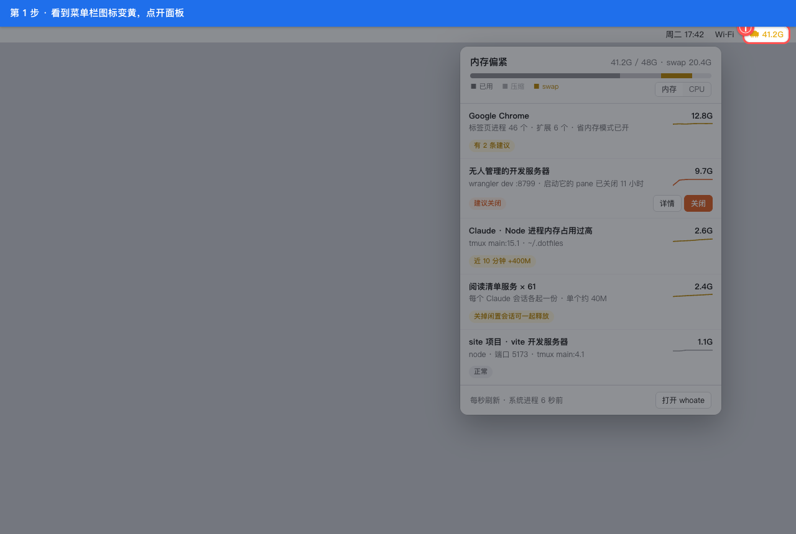
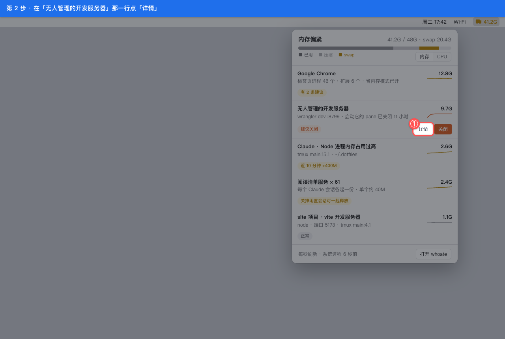
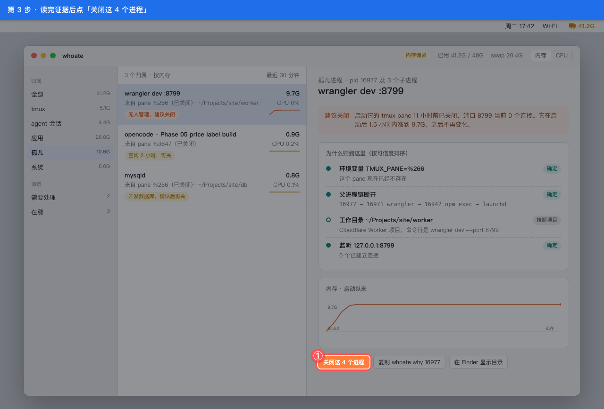
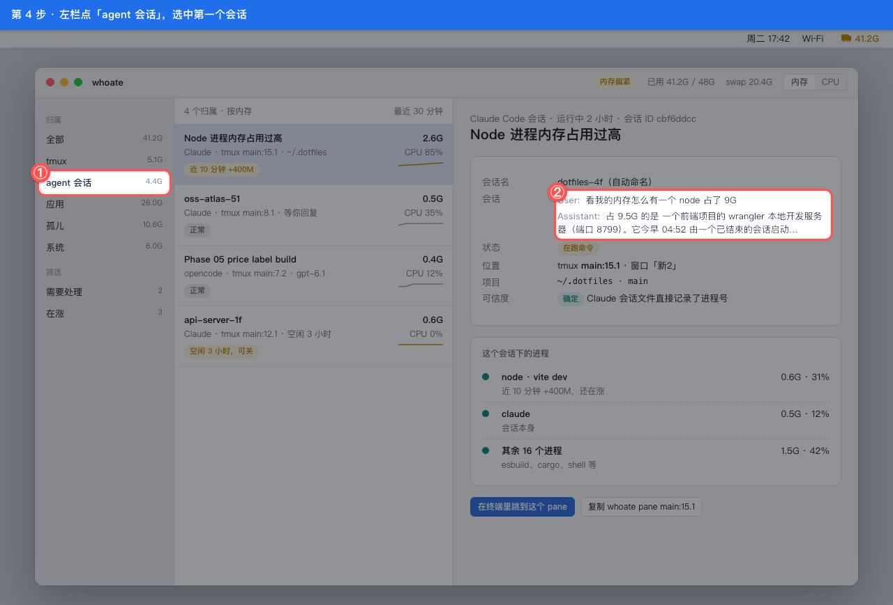
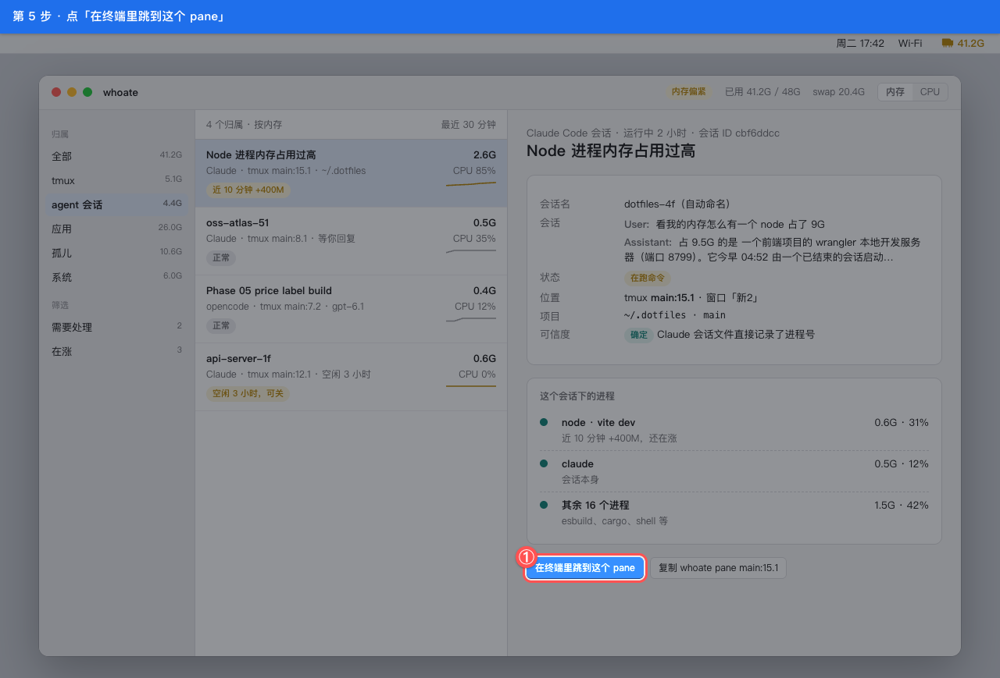
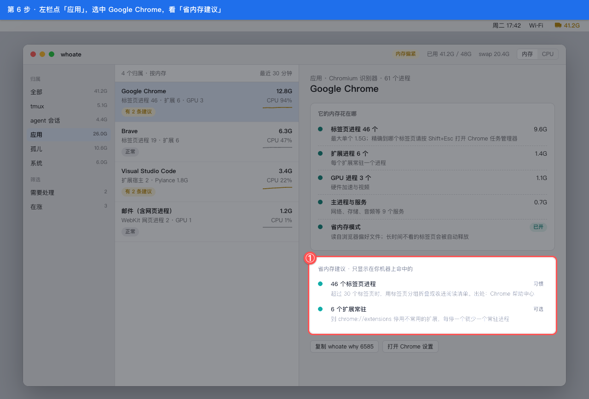

Audience:   P1 审批 owner | P2 跨职能
Scope:      内存偏紧时从菜单栏定位孤儿进程并关闭；在主窗口认出一个 Claude 会话并跳回它的终端 / Non-scope: 命令行用法（见 overview.md CLI 节）、设置页
State:      approved
Genre:      G-WALK
Code-Root:  /Users/zhenninglang/Projects/whoate-docs-design
Prefixes:   U-DIAG, U-ACC, U-BEH
Prototype:  mockups @ v0.1-2026-10-14

# whoate · 从菜单栏找到并关掉没人管的程序，再认出一个助手会话（用户故事对照原型）

## 1. 这段旅程一句话

同时开着好几个助手会话的开发者，从菜单栏图标进来，两次点击找到并关掉一个占 9.7G 的无人管理开发服务器，再在主窗口认出一个 Claude 会话、一键跳回它的终端。
故事来源：第 1–3 步来自 overview.md「场景化推演」的「孤儿大户」与今天的真实事故；第 4–5 步来自 owner 要求「定位到会话名和第一个问题」；各步的边界情况是本文新写的 [推断]。

## 2. 逐步对照

<!-- walk:auto-begin:steps -->
### 第 1 步 · 看到菜单栏图标变黄，点开面板

作为同时开着好几个助手会话的开发者，我想要在内存偏紧时一眼看出最大的问题是谁，以便不用打开活动监视器逐个猜（来源 [U-DIAG-1|a758]）

面板顶部是内存压力条和「内存 / CPU」排序切换，下面 5 行按内存从大到小排；「无人管理的开发服务器 9.7G」标着「建议关闭」，同样的小进程合成「阅读清单服务 × 61」一行。切到 CPU 排序后，列表改按 CPU 占用排；内存正常时图标保持灰色。

### 第 2 步 · 在「无人管理的开发服务器」那一行点「详情」

作为开发者，我想要先知道凭什么说它没人管，以便放心关掉而不是误杀正在用的服务（来源 [U-ACC-4|ba7a]）

主窗口打开并选中这个孤儿进程。不想看证据也可以直接点同一行的「关闭」，同样先弹确认。

### 第 3 步 · 读完证据后点「关闭这 4 个进程」

作为开发者，我想要看到它来自哪个已关闭的终端、监听的端口有没有人连，以便确认关掉不会影响别的事（来源 [U-BEH-1|033d]、[U-ACC-6|0f94]）

弹出确认框列出 4 个进程号，确认后先正常结束，5 秒没退再问是否强制。选中的是系统进程时按钮置灰，提示「系统进程，勿关」。

### 第 4 步 · 左栏点「agent 会话」，选中第一个会话

作为开发者，我想要认出占内存的是哪个助手会话、当时问的是什么，以便决定要不要回去处理它（来源 [U-ACC-5|061f]）

右栏显示会话标题「Node 进程内存占用过高」；会话名下面「会话」一行是开头的一问一答（User 一句、Assistant 回复的开头），再往下是所在终端位置和会话下的进程。opencode 或 kilo 的会话靠目录和时间配对，可信度一栏显示「推断」。

### 第 5 步 · 点「在终端里跳到这个 pane」

作为开发者，我想要一键回到那个会话所在的终端，以便直接在那里处理（来源 [U-ACC-5|061f]）

终端切到 tmux main:15.1，whoate 窗口留在原处。会话不在 tmux 里时按钮置灰，改为显示「在 Finder 显示目录」。

### 第 6 步 · 左栏点「应用」，选中 Google Chrome，看「省内存建议」

作为开着几十个标签页的开发者，我想要知道浏览器的内存花在标签页、扩展还是 GPU 上，以及在我这台机器上具体能怎么省，以便不用去网上搜一堆泛泛的建议（来源 [U-ACC-9|f303]）

右栏先按标签页进程、扩展、GPU、服务拆开内存，并读出省内存模式已开；再列出只在你机器上命中的建议，例如标签页进程超过 30 个、6 个扩展常驻。没有命中任何建议时，这张卡片不出现；精确到哪个标签页做不到，建议里会引导你按 Shift+Esc 打开浏览器自带的任务管理器。

<!-- walk:auto-end:steps -->

## 3. 原型没覆盖的步骤

| 故事步 | 缺什么 | 处置 |
|---|---|---|
| 助手用命令行查询 | 命令行没有界面原型 | 故意不做：命令与 JSON 格式见 overview.md 的 CLI 节 |
| 首次打开时系统拦截 | 原型没有这一屏 | 下期：取决于 approval.md 第 2 节第 1 件（是否公证） |
| 设置页（刷新间隔、语言） | 原型没有这一屏 | 下期：P4 实现时补，语言取决于第 2 节第 4 件 |

## 4. 全景索引

<!-- walk:auto-begin:index -->
| 步号 | 页面/路由 | 截图文件 | 对应登记 ID |
|---|---|---|---|
| 第 1 步（S1） | `mockups/menubar.html` | `walkthrough/S1.png` | [U-DIAG-1|a758] |
| 第 2 步（S2） | `mockups/menubar.html` | `walkthrough/S2.png` | [U-ACC-4|ba7a] |
| 第 3 步（S3） | `mockups/window-orphan.html` | `walkthrough/S3.png` | [U-BEH-1|033d]、[U-ACC-6|0f94] |
| 第 4 步（S4） | `mockups/window-agent.html` | `walkthrough/S4.png` | [U-ACC-5|061f] |
| 第 5 步（S5） | `mockups/window-agent.html` | `walkthrough/S5.png` | [U-ACC-5|061f] |
| 第 6 步（S6） | `mockups/window-browser.html` | `walkthrough/S6.png` | [U-ACC-9|f303] |

<!-- walk:auto-end:index -->
